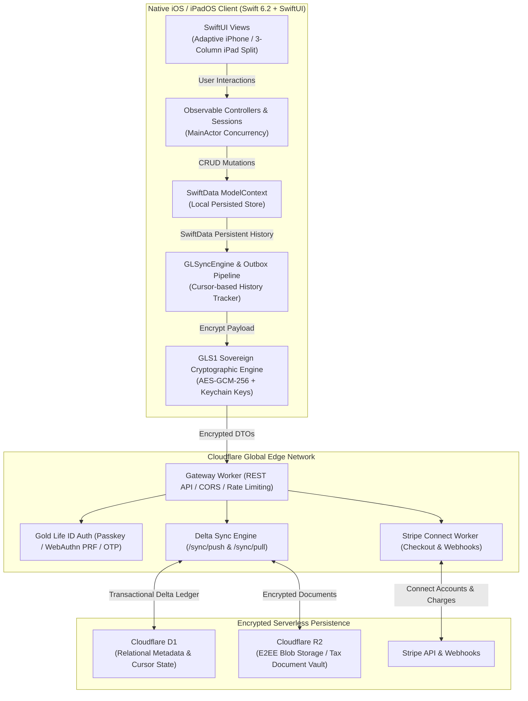

# My Business — iOS & iPadOS Architecture & System Design

> **Production Application Overview for Engineering Recruiters & Hiring Teams**  
> **Developer:** Adrian Gutierrez ([Software by GL](https://softwarebygl.com) · [LinkedIn](https://linkedin.com/in/adrian93gutierrez))  
> **App Store Page:** [My Business on Software by GL](https://softwarebygl.com/my-business)  
> **Tech Stack:** Swift 6.2 · SwiftUI · SwiftData · Cloudflare Workers (TypeScript) · Cloudflare D1 (Serverless SQLite) · Stripe Connect · GLS1 Zero-Knowledge Encryption

---

## 1. Executive Summary

**My Business** is a native iOS and iPadOS business operations application handcrafted solo by Adrian Gutierrez. Built specifically for independent trade contractors, subcontractors, and small field service operators, it provides end-to-end tooling for:

* **Customer & Job Management:** Complete lifecycle management linking jobs, addresses, contacts, and tax status.
* **Estimates & Invoicing:** Fluid line-item generation (labor, materials, fixtures, permits) converting seamlessly into PDF estimates and invoices.
* **Stripe Card Processing:** Instant server-minted direct checkout links allowing field contractors to accept customer card payments on-site.
* **1099-NEC & IRS Compliance:** Real-time subcontractor payout tracking with automated IRS threshold tracking ($2,000 threshold for 2026+) and instant Form 1099-NEC generation.
* **On-Device Expense Scanning:** Machine learning OCR receipt scanning extracting vendor, date, and sales totals into categorized expense ledgers.

---

## 2. High-Level Data Flow & System Architecture



---

## 3. Core Architecture & Design Patterns

### A. Unidirectional Data Flow with Swift 6 Concurrency
* **`@Observable` Architecture:** Eliminates legacy Combine boilerplate and publisher retention loops in favor of fine-grained observation tracking.
* **`@MainActor` Isolation:** UI state and presentation controllers are strictly bound to the MainActor to guarantee thread safety and eliminate data races at compile time under Swift 6.2 strict concurrency.
* **Offline-First Reactive Local Store:** SwiftData acts as the single immediate source of truth. UI updates render at 120fps with zero network blocking. Network sync operates asynchronously in the background.

### B. Delta Sync Pipeline (`GLSyncEngine`)
Instead of standard full-payload syncing, the application uses an append-only transaction log and cursor architecture:
1. **Persistent History Tracking:** Captures fine-grained `DefaultHistoryToken` delta markers on local `ModelContext` saves.
2. **Outbox Coalescing Queue:** Offline mutations are recorded in an isolated transactional outbox. Upon reconnect, changes coalesce into ordered batch payloads.
3. **Optimistic Concurrency & Conflict Resolution:** High-water mark sequence cursors resolve merge conflicts deterministically.

### C. Sovereign Zero-Knowledge Cryptography (`GLS1`)
* Sensitive financial records, IRS Form 1099 tax numbers (TIN/SSN/EIN), and contractor packages are encrypted on-device before transmission.
* Keys reside exclusively in the Apple Keychain protected with `kSecAttrAccessibleAfterFirstUnlockThisDeviceOnly`.
* Server infrastructure acts solely as a blind zero-knowledge synchronization layer (`ciphertext`, `nonce`, and authentication tag).

### D. Multi-Platform Adaptive UI Engine
* **Universal 3-Column Split Standard:** On iPad (`UIDevice.current.userInterfaceIdiom == .pad`), renders a native 3-column split view (`NavigationSplitView`: Sidebar · List · Detail) across all orientations and multitasking configurations.
* **Adaptive Grid System:** Product and catalog items scale dynamically via adaptive layouts without stretching or pixel clipping across phone and tablet bounds.
* **Accessibility & Internationalization:** 100% native Dynamic Type compliance and synchronized English/Spanish (`en` / `es`) string catalogs.

---

## 4. Repository Structure

```
SmallBusinessApp/
├── GLSmallBusiness/
│   ├── AI/                   # Local tools, assistants & prompt pipelines
│   ├── Models/               # SwiftData schemas & versioned migrations (V1 -> V2)
│   ├── Screens/              # Domain screens (Invoices, Customers, Payroll, 1099, Calendar)
│   ├── UIComponents/         # Reusable design tokens, buttons, and formatters
│   ├── Services/             # OCR receipt scanner, PDF generator, Audio, Haptics
│   ├── Networking/           # REST API client, Stripe Connect, sync outbox pipelines
│   └── App/                  # App entrypoint, scene lifecycle, and deep-link routing
├── GLSmallBusinessTests/     # Unit test suites (concurrency, models, tax calculations)
├── GLSmallBusinessUITests/   # Programmatic UI automation and accessibility verification
├── Scripts/                  # Automated verification, linting, and CI/CD archiving pipelines
└── README.md                 # Full developer and technical documentation
```

---

## 5. Security & Verification Gates

The codebase strictly enforces the following engineering gates:
1. **Zero Secrets in Binary:** 100% of API keys, private keys, and platform secrets reside behind private backend Cloudflare Workers. Zero credentials exist in the client repository.
2. **Anti-Crash Guardrails:** Absolute ban on force unwrapping (`!`, `try!`, `as!`), unsafe array indexing, or unguarded environment injections. All user-facing errors fail gracefully.
3. **Automated Release Invariants:** Automated programmatic linting (`gl_invariant_lint.py`) executes AST and regex parsing before builds to guarantee navigation hierarchy, confirmation alerts, and layout parity.

---

## 6. Contact & Hiring Inquiries

**Adrian Gutierrez**  
*Email:* [adrian@softwarebygl.com](mailto:adrian@softwarebygl.com)  
*Portfolio:* [softwarebygl.com](https://softwarebygl.com)  
*GitHub:* [github.com/softwarebygl](https://github.com/softwarebygl)  
*LinkedIn:* [linkedin.com/in/adrian93gutierrez](https://linkedin.com/in/adrian93gutierrez)
